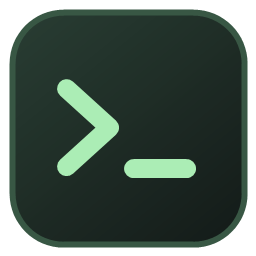
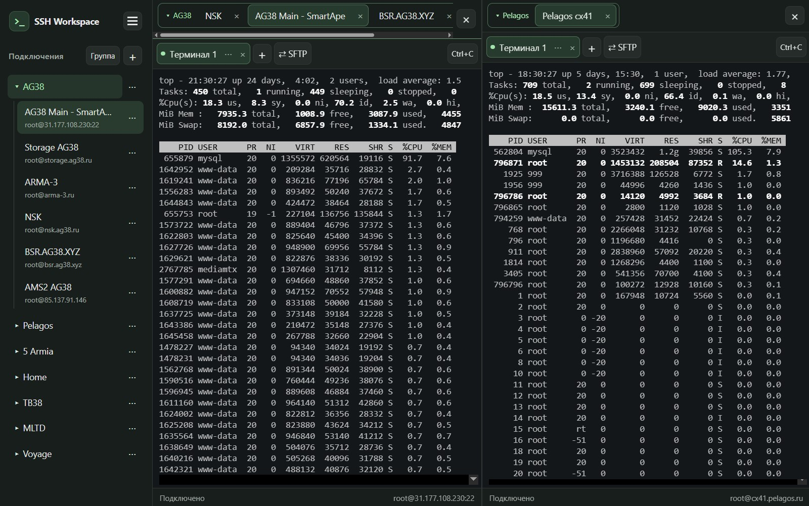
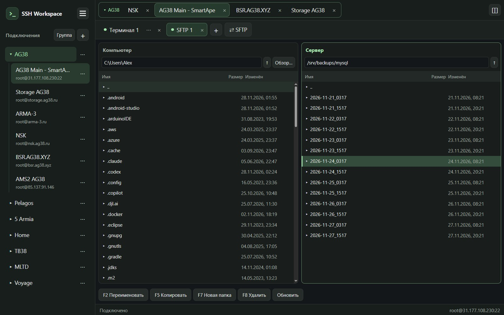
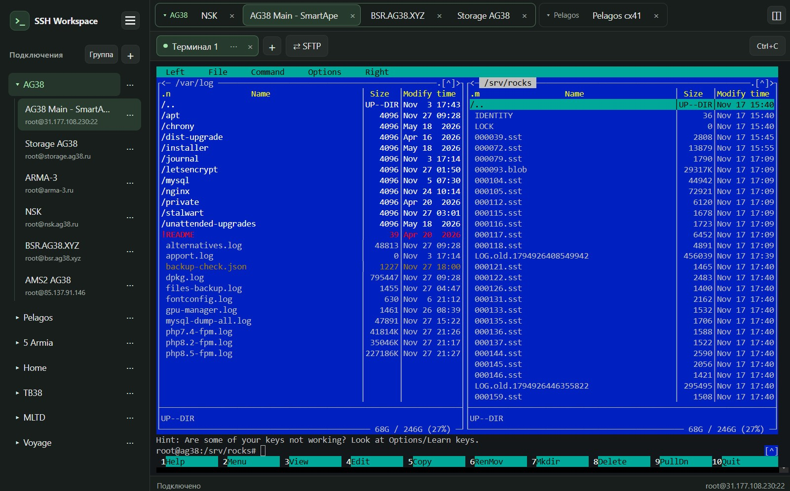

# SSH Workspace

**A modern alternative to PuTTY + WinSCP.**

Open SSH terminals and transfer files over SFTP in the same desktop app. Work with two terminals side by side, move live sessions between panes without reconnecting, and manage local and remote files in a two-panel file browser.

**Free, MIT-licensed, and open source. No account or subscription required.** Your connection profiles stay on your device.

**[Download for Windows, macOS, or Linux](https://github.com/AlexGnatko/SSH-Workspace/releases)** · [Build from source](#build-from-source) · [MIT license](LICENSE)

## Screenshots

[](screen2.jpg)

| Two-panel SFTP | Midnight Commander over SSH |
| --- | --- |
| [](screen3.jpg) | [](screen1.jpg) |

## Install on Windows

1. Download the Windows x64 `.msi` from the **Assets** section of a [GitHub release](https://github.com/AlexGnatko/SSH-Workspace/releases).
2. Run the installer, then open **SSH Workspace** from the Start menu.

The installer bundles the app and its runtime. SSH Workspace uses the Windows **OpenSSH Client** optional feature to run SSH terminals and read OpenSSH configuration. Enable it in Windows if it is missing.

## Build from source

You need Node.js 22.12 or later and the system OpenSSH client. Run `node -v` and `ssh -V` to check the installed versions.

```sh
npm ci
npm start
```

Electron downloads its binary on first use. An older version of Node.js may report `ERR_REQUIRE_ESM` during this step. After upgrading Node.js, open a new terminal and run the commands again.

Run the Windows build commands from Windows. If you run the project in WSL, use a separate checkout such as `~/SSH-Workspace`. Windows and Linux use different native dependencies in `node_modules`. If installing from WSL replaces the Windows dependencies in a shared folder, run `npm ci` from Windows to restore them.

Run `npm run package:win` on Windows to build a portable copy in `release/<version>/win-unpacked`. Open `SSH Workspace.exe` there and keep the entire folder together when moving the build. Run `npm run build` to compile the app without packaging it.

## Distribution packages

After `npm ci`, build on the target operating system and architecture. Packages are written to `release/<version>`.

| Platform | Command | Format |
| --- | --- | --- |
| Windows x64 | `npm run package:msi` | MSI |
| Linux x64 | `npm run package:linux` | AppImage |
| macOS (Apple Silicon and Intel) | `npm run package:mac` | DMG for the build machine's architecture |

Building `node-pty` on Linux requires Python 3, make, and a C++ compiler. Make the AppImage executable with `chmod +x <file>.AppImage`. The system OpenSSH client must be on `PATH` on Linux and macOS.

Build the Windows MSI and Linux AppImage locally using the commands above. To build both macOS packages on GitHub, open **Actions → Build macOS packages → Run workflow** once the workflow is on the default branch. Download the Intel and Apple Silicon DMGs from **Artifacts** on the run page.

The workflow is configured for builds without an Apple Developer ID certificate or notarization. Developer ID signing and notarization allow downloaded apps to open through Gatekeeper without a manual exception. Native Apple Silicon code requires a valid signature, and an ad hoc signature is sufficient for a test build. Verify the signature and first launch of the downloaded DMG on a Mac. [Apple's guide to opening apps](https://support.apple.com/en-us/102445)

## Interface and license

Open the app menu with the menu button or by clicking the SSH Workspace logo. Settings offers Russian, English, German, French, and Spanish. Language changes apply the next time you open the app. OpenSSH and remote programs display their original output.

The SSH Workspace source code is available under the [MIT license](LICENSE). Bundled third-party license texts are available from **About**.

## Connections

Save a connection profile in the sidebar and select it to connect. Use the **+** button next to the session tabs to open additional terminals.

- A profile accepts a hostname, IP address, or alias from `~/.ssh/config`. OpenSSH supplies the username and port when those fields are blank. Profiles are stored in the app's local user data.
- Use **Group** to create a profile group and assign profiles in their settings. The sidebar shows one expanded group at a time, and the top tab bar shows open profiles under their group names. Collapsing a group leaves its sessions connected.
- The button at the top right splits the workspace into two panes, each with its own profile and session tabs. Select a pane, then choose a profile from the shared sidebar. Closing a pane ends its sessions and expands the other pane.
- When two or more SSH terminals are open, use a terminal tab's **⋯** button or right-click the tab to open its menu. **Move to the other pane** moves the live session and its terminal history. The right pane opens automatically if needed. An empty pane closes after a move. SFTP tabs stay open in their original pane.
- Passwords are optional. The app encrypts saved passwords using Electron's `safeStorage`. **Enter password** appears when OpenSSH asks for the account password. Respond to host key confirmations, key passphrase requests, and interactive login prompts in the terminal.
- Host, username, and port changes apply to new terminals. Changing any of those fields clears the saved password unless you enter a replacement.
- A clean exit from the remote shell closes the tab. After a network failure, the terminal stays open and retries with a delay of 2 to 30 seconds. If the server requires a password, use **Enter password** again or type it manually.
- Closing an SSH or SFTP tab ends the associated connection. Sessions in other tabs continue running.
- If the host key changes during SSH or SFTP, the client shows the old and new fingerprints. Verify the new fingerprint with the hosting control panel or server administrator before replacing it. The client can update a matching entry in the user's `known_hosts` when the match is unambiguous. It can also replace the SFTP key saved in the profile.
- The tmux option runs `tmux new -As work`. Terminals that use this option with the same server and username attach to the same tmux session.
- The terminal can copy on selection and paste on right-click. Both options are configurable. `Ctrl+Shift+C`, `Ctrl+Shift+V`, and `Ctrl+V` also work. Pasting multiple lines requires confirmation unless the terminal program has enabled bracketed paste.

On the tested version of Windows 10, ConPTY may hide bracketed paste mode from the terminal. The client asks for confirmation before pasting multiple lines in that case.

## Files

Use **⇄ SFTP** to open an independent file tab for the current profile. Local files are on the left and remote files are on the right. You can open multiple file tabs. Each new tab restores the profile's last-used folders.

- `Tab` switches panels. Use the arrow keys to move the cursor, `Enter` to open a folder, `Backspace` to go up a level, and `Insert` to mark multiple items.
- `F5` opens the copy dialog for the opposite panel. Press `Enter` to confirm or `Escape` to cancel. `F8` deletes selected items after confirmation, `F7` creates a folder, and `F2` renames an item. Copying stops on a name conflict.
- During a copy, the progress panel shows the transferred size, file count, and estimated time remaining.
- Right-click a remote item to open **Copy path** or **Permissions…**. The permissions dialog supports R/W/X permissions, special bits, and numeric octal mode. Enter a numeric UID or GID to change the owner or group. Recursive updates skip symbolic links and use the current server account's permissions.
- SFTP verifies the host key against `known_hosts` or asks for approval on first use. Use a saved or one-time password, the SSH agent, or an unencrypted key. Use the agent for encrypted keys. This version connects to SFTP directly.

